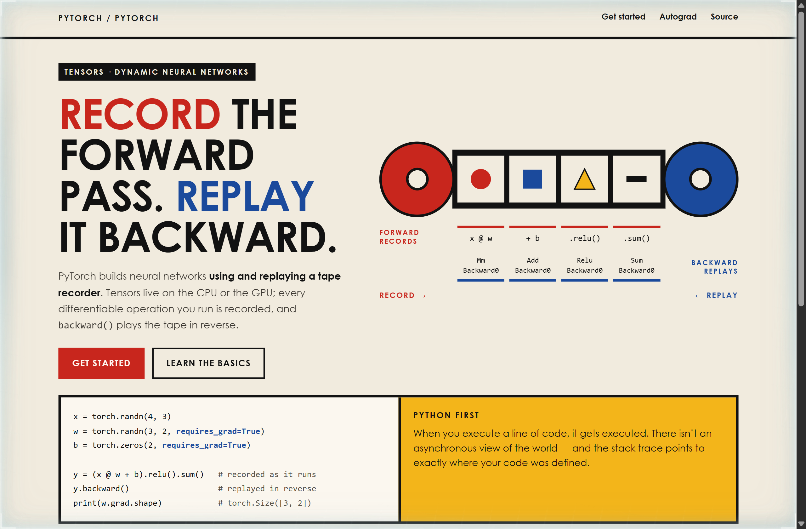
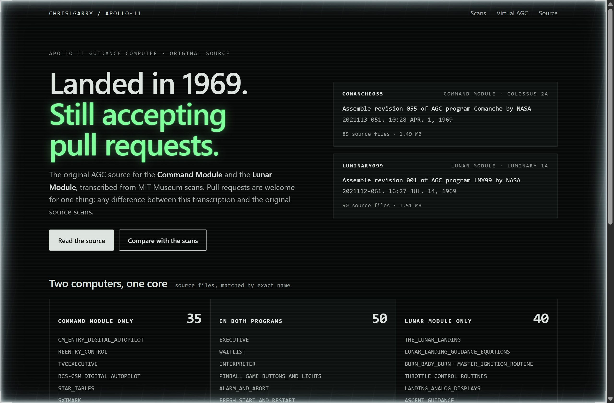
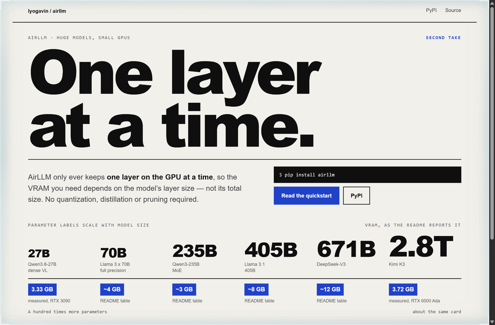

# Design Rep — Sunday, October 11

> 3 mocks — bauhaus, neon-noir, poster

[Catalog](../../CATALOG.md) · [Home](../../README.md)

## [pytorch/pytorch](https://github.com/pytorch/pytorch)

- **Style:** bauhaus / tape-red
- **Idea tested:** Draw autograd as the README's own tape recorder, a red reel recording four operations forward and a blue reel replaying their gradient functions backward
- **Verdict:** A literal tape makes define-by-run legible at a glance, and a second run with a different tape explains dynamic graphs without the jargon
- [live .html](./01-pytorch.html) · [repo on GitHub](https://github.com/pytorch/pytorch)

## [chrislgarry/Apollo-11](https://github.com/chrislgarry/Apollo-11)

- **Style:** neon-noir / dsky-green
- **Idea tested:** Split the two programs by file name into Command Module only, shared and Lunar Module only, and spend the one neon on the line saying it still takes pull requests
- **Verdict:** The shared core and the vehicle-specific edges tell the mission's story from the file list alone
- [live .html](./02-apollo-11.html) · [repo on GitHub](https://github.com/chrislgarry/Apollo-11)

## [lyogavin/airllm](https://github.com/lyogavin/airllm)

- **Style:** poster / layer-cobalt
- **Idea tested:** Set the trick as the poster headline, then size each model's parameter count by scale while its VRAM chip stays the same size
- **Verdict:** When the labels grow and the chips do not, the claim reads before any explanation, and the disk cost sits right beside it
- [live .html](./03-airllm.html) · [repo on GitHub](https://github.com/lyogavin/airllm)
