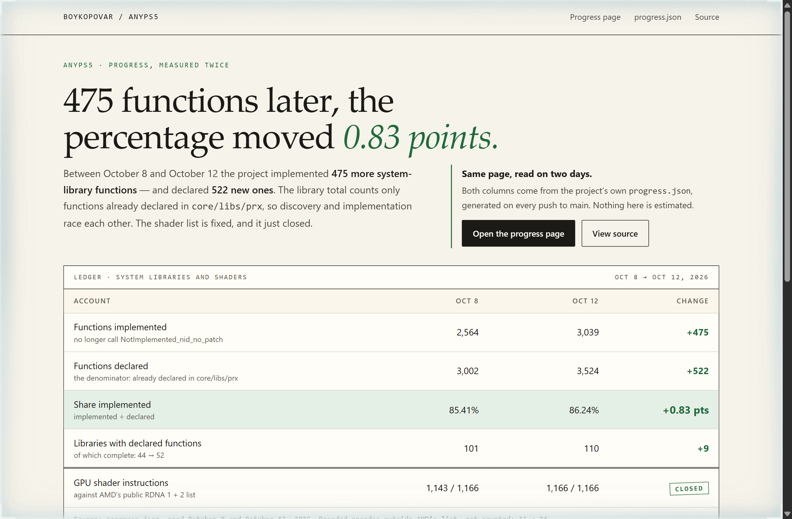
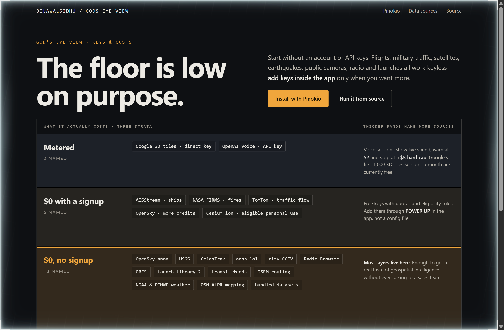
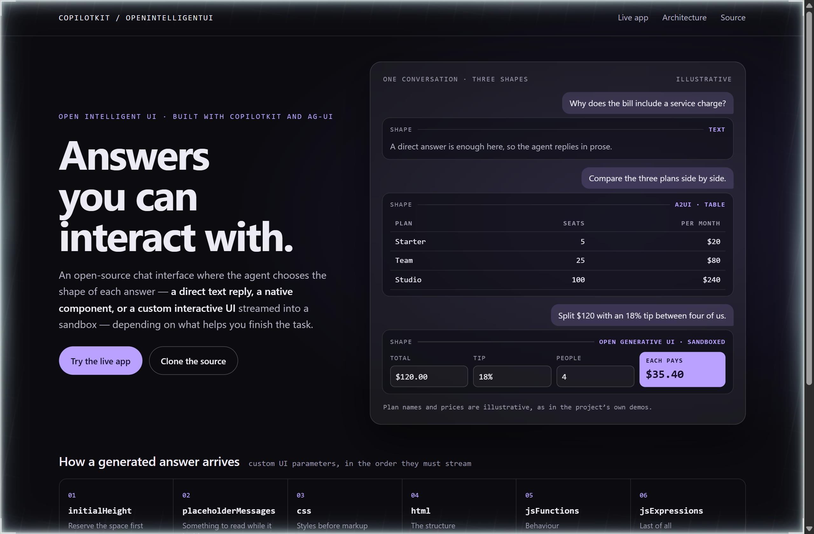

# Design Rep — Monday, October 12

> 3 mocks — ledger, strata, glass

[Catalog](../../CATALOG.md) · [Home](../../README.md)

## [boykopovar/AnyPS5](https://github.com/boykopovar/AnyPS5)

- **Style:** ledger / close-green
- **Idea tested:** Read the same progress file on two days and set it as a ledger, with the growing denominator on its own row beside the headline percentage
- **Verdict:** Two dated columns tell a truer story than one percentage, because the libraries that slipped did so when more of them was found
- [live .html](./01-anyps5.html) · [repo on GitHub](https://github.com/boykopovar/AnyPS5)

## [bilawalsidhu/gods-eye-view](https://github.com/bilawalsidhu/gods-eye-view)

- **Style:** strata / floor-amber
- **Idea tested:** Draw the README's cost section as strata, each band as thick as the number of sources it holds, so the free floor is visibly the thickest layer
- **Verdict:** Sizing each band by its source count proves "mostly free" at a glance, and stating the ceiling beside it keeps the claim honest
- [live .html](./02-gods-eye-view.html) · [repo on GitHub](https://github.com/bilawalsidhu/gods-eye-view)

## [CopilotKit/OpenIntelligentUI](https://github.com/CopilotKit/OpenIntelligentUI)

- **Style:** glass / router-violet
- **Idea tested:** Show one conversation answered in three shapes inside a single frosted panel, then print the order a generated answer streams in
- **Verdict:** Three shapes in one thread explain "the agent picks the interface" faster than any diagram, and the streaming order gives builders something they can check
- [live .html](./03-open-intelligent-ui.html) · [repo on GitHub](https://github.com/CopilotKit/OpenIntelligentUI)
