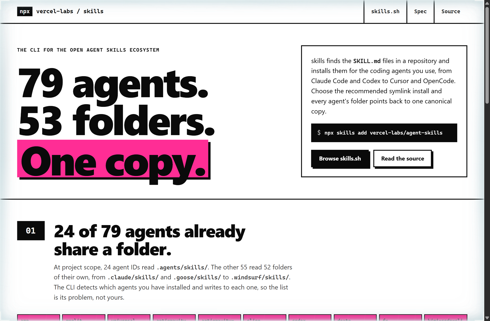
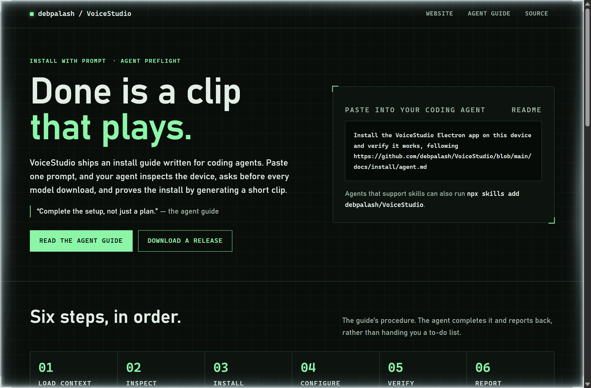
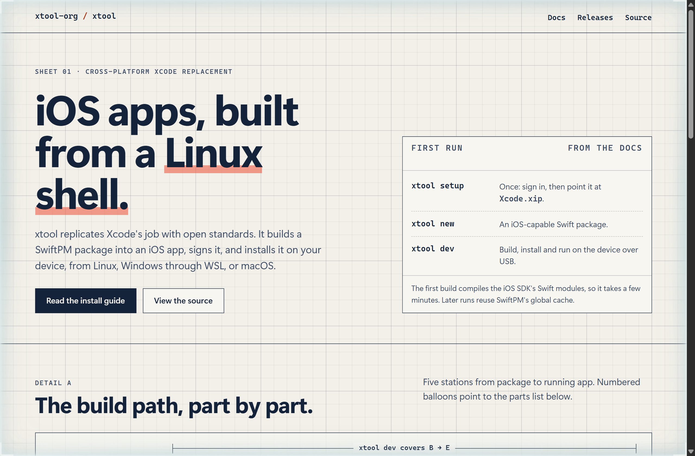

# Design Rep — Tuesday, October 13

> 3 mocks — brutalist, hud, blueprint

[Catalog](../../CATALOG.md) · [Home](../../README.md)

## [vercel-labs/skills](https://github.com/vercel-labs/skills)

- **Style:** brutalist / link-magenta
- **Idea tested:** Set the README's agent table as 79 hard-bordered cells, the 24 that share .agents/skills/ filled in magenta, under a headline made of three counts
- **Verdict:** Counting the folders makes "works with every agent" concrete, and shows the work the CLI absorbs so you don't have to
- [live .html](./01-skills.html) · [repo on GitHub](https://github.com/vercel-labs/skills)

## [debpalash/VoiceStudio](https://github.com/debpalash/VoiceStudio)

- **Style:** hud / preflight-green
- **Idea tested:** Set the install guide written for coding agents as a preflight, with verification as a ladder of API calls and one amber caution on the rung that looks finished early
- **Verdict:** Ending on a clip that plays gives the reader a promise they can check, and the amber rung marks where a hurried agent would stop too soon
- [live .html](./02-voicestudio.html) · [repo on GitHub](https://github.com/debpalash/VoiceStudio)

## [xtool-org/xtool](https://github.com/xtool-org/xtool)

- **Style:** blueprint / swift-orange
- **Idea tested:** Draw the build path as a drafting sheet with a parts list, and call out the one part that is still Xcode
- **Verdict:** Naming the Xcode.xip that the replacement still needs makes the claim credible instead of hype
- [live .html](./03-xtool.html) · [repo on GitHub](https://github.com/xtool-org/xtool)
