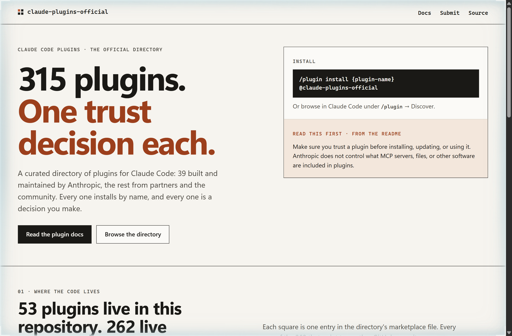
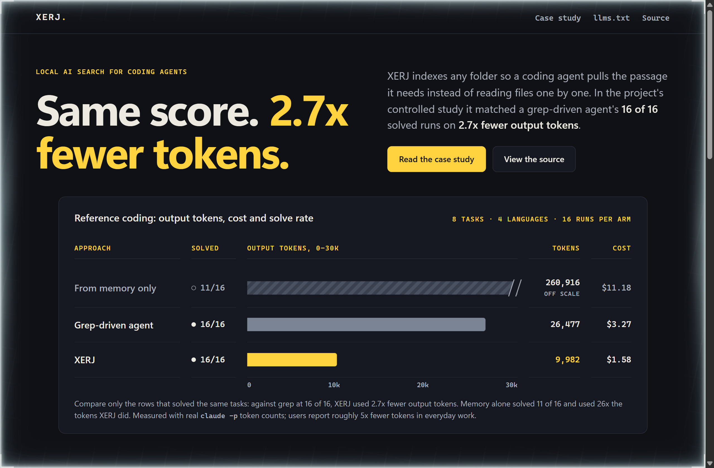
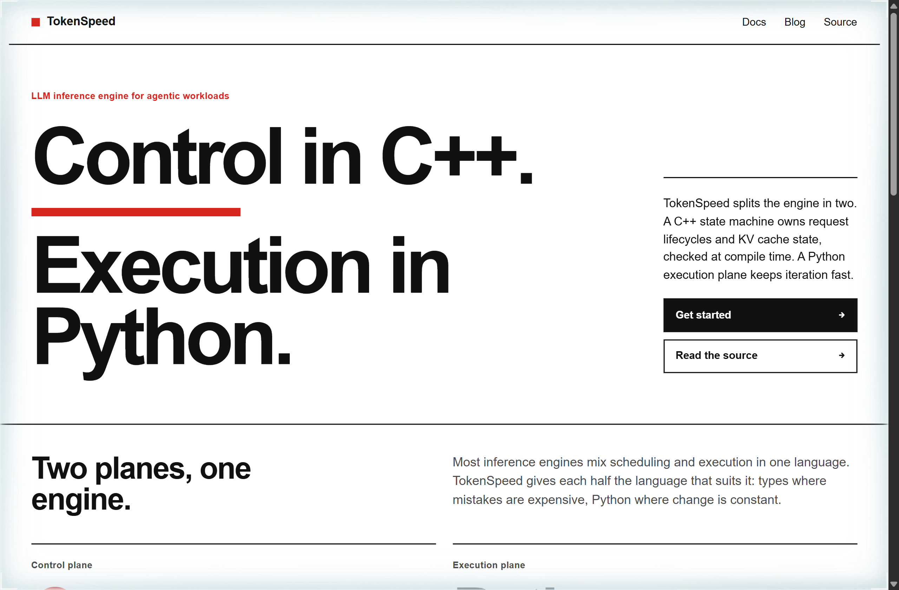

# Design Rep — Thursday, October 15

> 3 mocks — cell-grid, data-viz, swiss

[Catalog](../../CATALOG.md) · [Home](../../README.md)

## [anthropics/claude-plugins-official](https://github.com/anthropics/claude-plugins-official)

- **Style:** cell-grid / clay-orange
- **Idea tested:** Draw all 315 directory entries as equal cells grouped by where their code lives, with the README's trust warning beside the install command
- **Verdict:** Counting where the code lives turns "trust each plugin" from boilerplate into something you can see
- [live .html](./01-claude-plugins.html) · [repo on GitHub](https://github.com/anthropics/claude-plugins-official)

## [xerj-org/xerj](https://github.com/xerj-org/xerj)

- **Style:** data-viz / passage-yellow
- **Idea tested:** Hold the solve rate fixed and compare tokens only between runs that solved the same tasks, with the off-scale memory run marked as not comparable
- **Verdict:** Gating the comparison on equal outcomes makes 2.7x believable, and printing where it doesn't help makes it trustworthy
- [live .html](./02-xerj.html) · [repo on GitHub](https://github.com/xerj-org/xerj)

## [lightseekorg/tokenspeed](https://github.com/lightseekorg/tokenspeed)

- **Style:** swiss / neutral-red
- **Idea tested:** Split the hero and the grid along the engine's own seam, C++ control plane against Python execution plane, with red reserved for the control side
- **Verdict:** Letting the architecture set the grid explains the engine before any benchmark appears
- [live .html](./03-tokenspeed.html) · [repo on GitHub](https://github.com/lightseekorg/tokenspeed)
