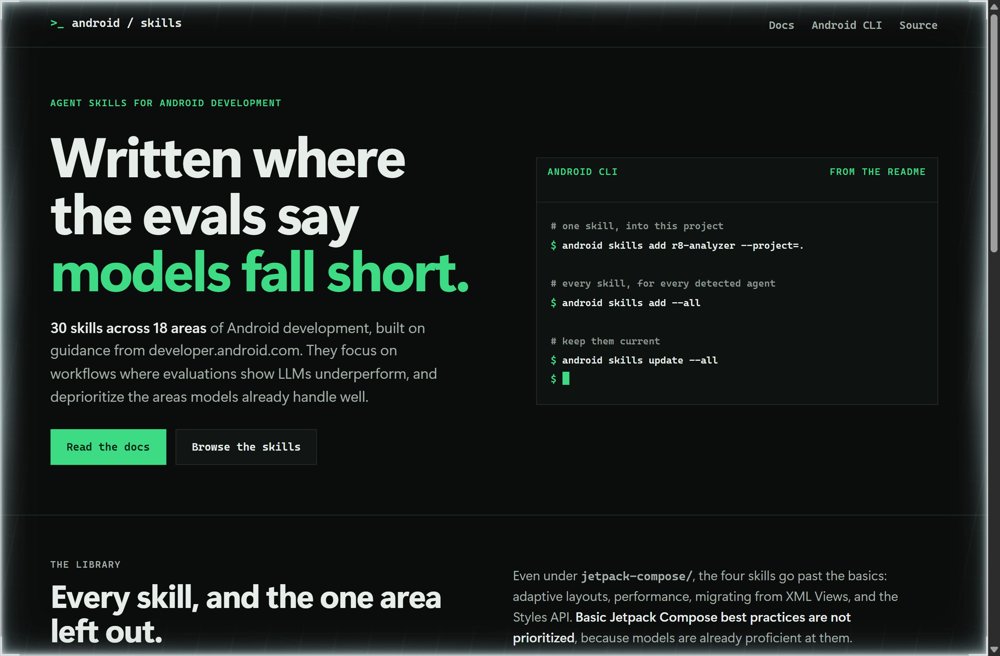
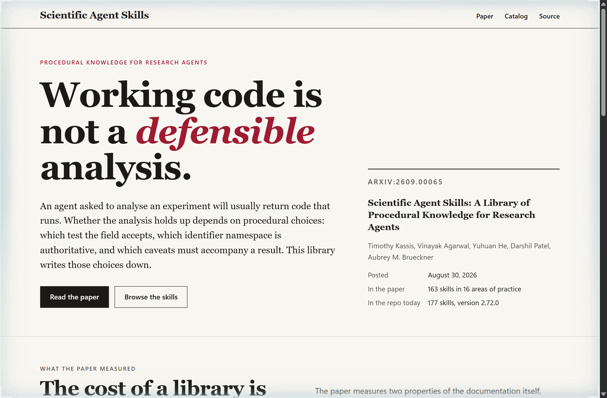
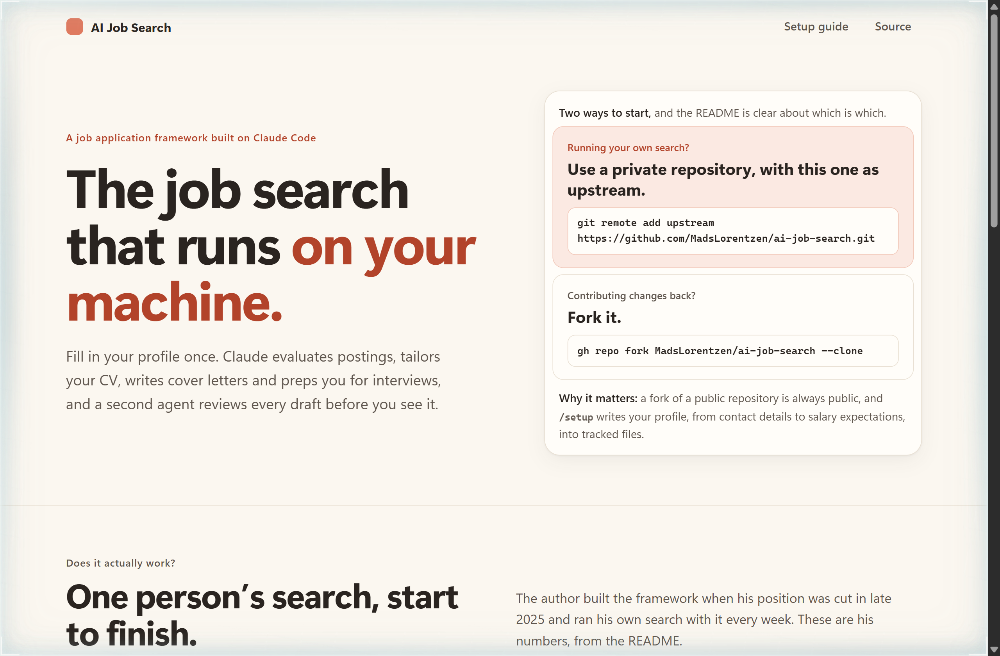

# Design Rep — Friday, October 16

> 3 mocks — terminal-dark, editorial, warm-minimal

[Catalog](../../CATALOG.md) · [Home](../../README.md)

## [android/skills](https://github.com/android/skills)

- **Style:** terminal-dark / gap-green
- **Idea tested:** Print the whole skill tree and mark in place the one area the README deprioritizes, basic Jetpack Compose
- **Verdict:** Showing the gap the library chose not to fill makes "eval-driven" concrete in a way a feature list cannot
- [live .html](./01-android-skills.html) · [repo on GitHub](https://github.com/android/skills)

## [K-Dense-AI/scientific-agent-skills](https://github.com/K-Dense-AI/scientific-agent-skills)

- **Style:** editorial / caveat-crimson
- **Idea tested:** Lead with the paper's distinction between working code and a defensible analysis, chart its context-cost measurements, and give its stated missing evaluation the same weight
- **Verdict:** A research page that prints its own caveat earns more trust than one that opens on counts
- [live .html](./02-scientific-agent-skills.html) · [repo on GitHub](https://github.com/K-Dense-AI/scientific-agent-skills)

## [MadsLorentzen/ai-job-search](https://github.com/MadsLorentzen/ai-job-search)

- **Style:** warm-minimal / upstream-coral
- **Idea tested:** Replace the fork button with the README's two doors, a private repository for your own search and a fork only to contribute, then show the author's own results
- **Verdict:** Putting the privacy advice where the fork button usually sits turns a footnote into the first decision
- [live .html](./03-ai-job-search.html) · [repo on GitHub](https://github.com/MadsLorentzen/ai-job-search)
